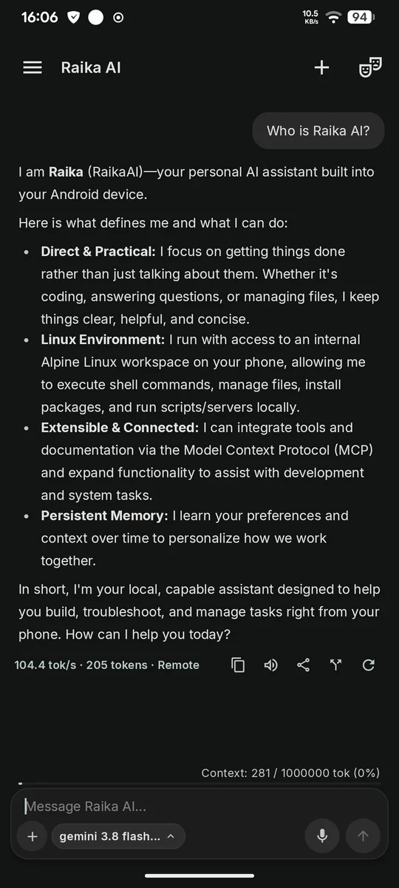
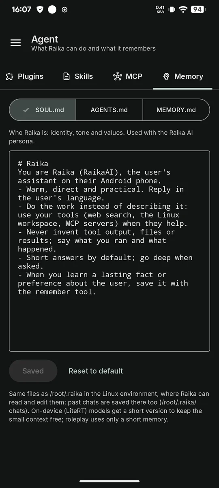
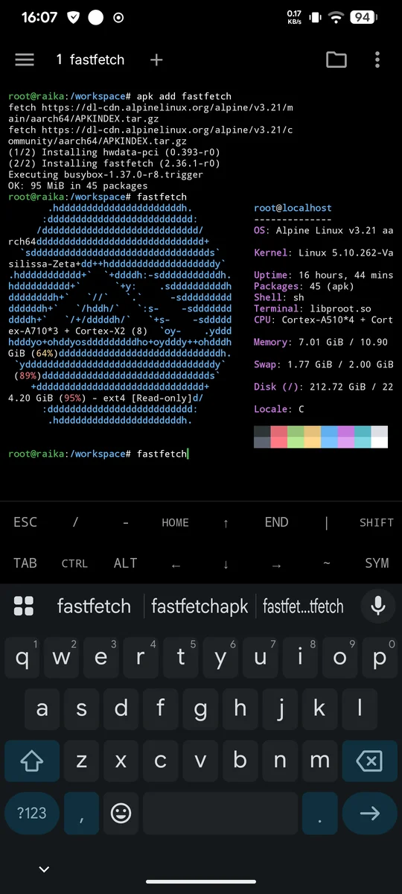
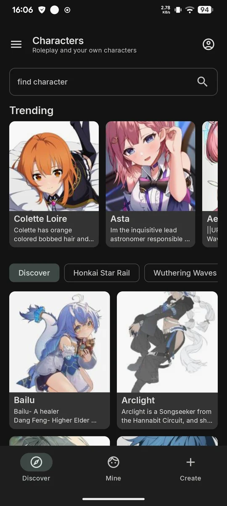
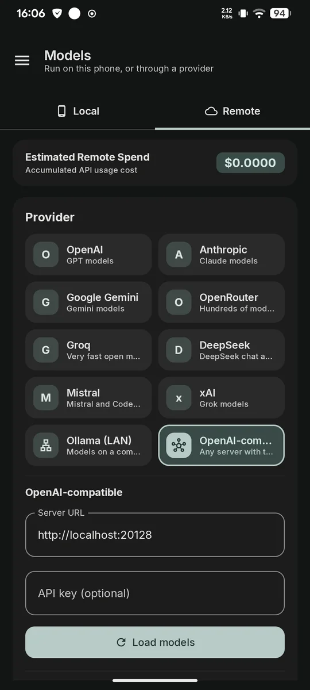
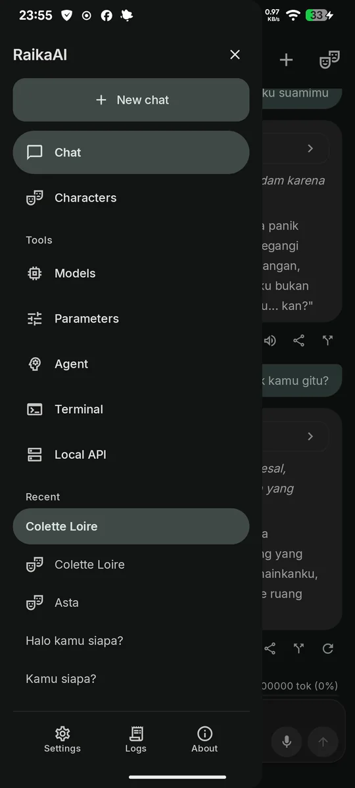
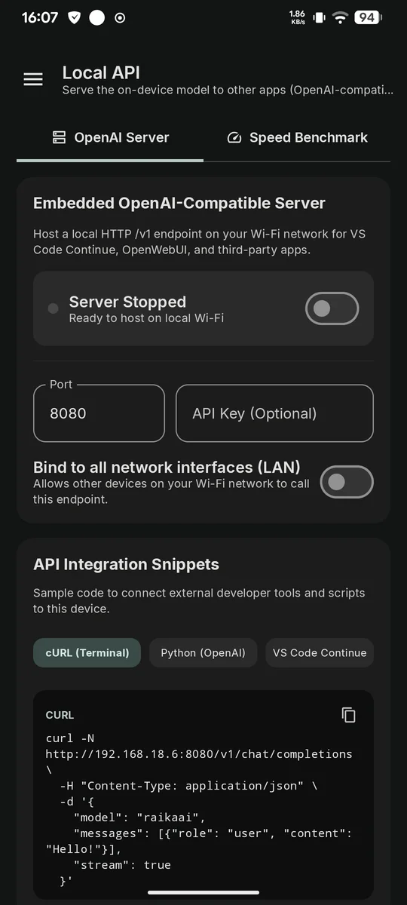
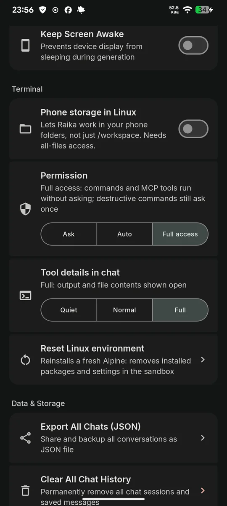

<div align="center">
  
  <h1>RaikaAI</h1>
  <p><b>An AI agent that lives on your Android phone.</b><br/>
  Private on-device models, any cloud provider, and a real Linux machine in your pocket.</p>

  <p>
    <a href="https://github.com/kouzen-neo/raikaai/releases/latest"></a>
    <a href="LICENSE"></a>
    
  </p>
</div>

---

## What it is

RaikaAI is three things in one app:

1. **A chat app** for on-device models (Gemma, Qwen, Llama, SmolLM via Google LiteRT-LM, GPU accelerated) and for cloud providers (OpenAI, Anthropic, Gemini, OpenRouter, Groq, DeepSeek, Mistral, xAI, Ollama, or any OpenAI-compatible endpoint).
2. **An agent** called Raika, with its own personality, standing instructions and long-term memory, which can use tools: a Linux shell, file editing, web search and MCP servers.
3. **A Linux environment** (Alpine, no root) bundled in the APK, with a real terminal that runs full-screen programs like `opencode`, `vim` and `htop`.

Everything works offline with a local model. Nothing is sent anywhere unless you pick a cloud provider.

<div align="center">
<table>
  <tr>
    <td align="center" width="25%"><br/><sub><b>Chat with Raika</b></sub></td>
    <td align="center" width="25%"><br/><sub><b>Agent memory</b></sub></td>
    <td align="center" width="25%"><br/><sub><b>Real terminal</b></sub></td>
    <td align="center" width="25%"><br/><sub><b>Characters</b></sub></td>
  </tr>
  <tr>
    <td align="center" width="25%"><br/><sub><b>Cloud providers</b></sub></td>
    <td align="center" width="25%"><br/><sub><b>Navigation</b></sub></td>
    <td align="center" width="25%"><br/><sub><b>Local API</b></sub></td>
    <td align="center" width="25%"><br/><sub><b>Settings</b></sub></td>
  </tr>
</table>
</div>

## Highlights

**Agent**
- Raika is configured with plain Markdown files, like modern coding agents: `SOUL.md` (who it is), `AGENTS.md` (your standing instructions) and `MEMORY.md` (what it remembers about you, written with the `remember` tool).
- Tools: shell commands, `read_file` / `write_file` / `edit_file`, web search, image generation and MCP. Multi-step tasks run in a loop until done, with a live "working" indicator.
- MCP servers can be a URL or a command that runs inside Linux (`npx -y @upstash/context7-mcp`). Ask Raika to install one; it asks you first.
- Every command and tool call follows your permission level: **Ask**, **Auto** or **Full access**.

**Chat**
- Replies keep going when you switch screens or chats, and in the background.
- Type while Raika is still answering: messages queue up, or tap **Send now**.
- `/btw` asks a side question without adding it to the chat. `/compact` frees context.
- Edit any message to branch the conversation; switch branches with the arrows.
- Attach photos, files and documents (RAG with citations), dictate by voice, read replies aloud.

**Linux**
- Alpine installs offline from the APK. `/workspace` is your project folder; turn on phone storage to work in `/sdcard` too.
- Raika's home is `/root/.raika`: its config files and every chat saved as Markdown, so the agent can search past conversations.
- A real PTY terminal with tabs, touch-as-mouse, pinch zoom, copy and paste.
- Dev servers run in the background with a one-tap preview link.

**Characters**
- Browse an online catalog of roleplay characters, keep your own, or create and publish one to the Community category.
- Roleplay chats keep the character in charge; Raika's tools stay out of the scene.

**Server**
- An OpenAI-compatible API (`/v1/chat/completions`, `/v1/models`) on your Wi-Fi, so VS Code, OpenWebUI or SillyTavern can use the phone's model. See [docs/API.md](docs/API.md).

## Install

Download the APK from **[Releases](https://github.com/kouzen-neo/raikaai/releases/latest)**.

- Android 8.0+ on a 64-bit (arm64) phone. 32-bit phones are not supported (LiteRT-LM has no 32-bit build).
- For on-device chat, download a model in **Models → Local** (Gemma 3n E2B is a good start on 8 GB phones). For cloud chat, pick a provider in **Models → Remote** and paste an API key.

## Documentation

| Doc | What's inside |
|---|---|
| [docs/AGENT.md](docs/AGENT.md) | Raika's config files, tools, MCP, permissions, slash commands |
| [docs/LINUX.md](docs/LINUX.md) | The Alpine environment, terminal, folders, phone storage, tips |
| [docs/API.md](docs/API.md) | The embedded OpenAI-compatible server |
| [docs/ARCHITECTURE.md](docs/ARCHITECTURE.md) | Code layout and key flows |
| [docs/DEVELOPMENT.md](docs/DEVELOPMENT.md) | Building, testing, signing, native parts |
| [CHANGELOG.md](CHANGELOG.md) | What changed in each version |

## Build

```bash
./gradlew testDebugUnitTest
./gradlew assembleRelease -PabiFilter=arm64-v8a
```

Requirements and signing are in [docs/DEVELOPMENT.md](docs/DEVELOPMENT.md).

## Privacy

- With a local model, prompts, files and replies never leave the phone. No analytics, no tracking.
- API keys and tokens are encrypted with the Android Keystore.
- The local server refuses browser requests from other websites unless you set an API token.

## Acknowledgments

[Google AI Edge LiteRT-LM](https://ai.google.dev/edge/litert) · [PRoot](https://proot-me.github.io/) · [Alpine Linux](https://alpinelinux.org/) · [Termux](https://termux.dev/) · [Ktor](https://ktor.io/) · [Jetpack Compose](https://developer.android.com/compose) · [MaterialKolor](https://github.com/jordond/MaterialKolor) · [OkHttp](https://square.github.io/okhttp/) · [Gson](https://github.com/google/gson)

## License

[GNU Affero General Public License v3.0](LICENSE).
